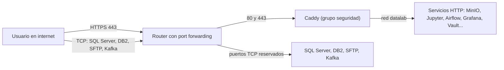
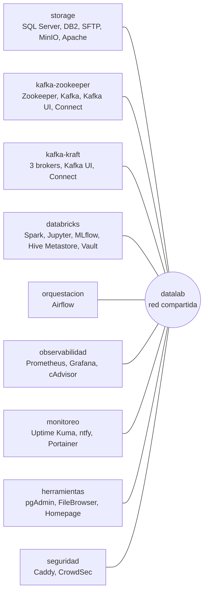
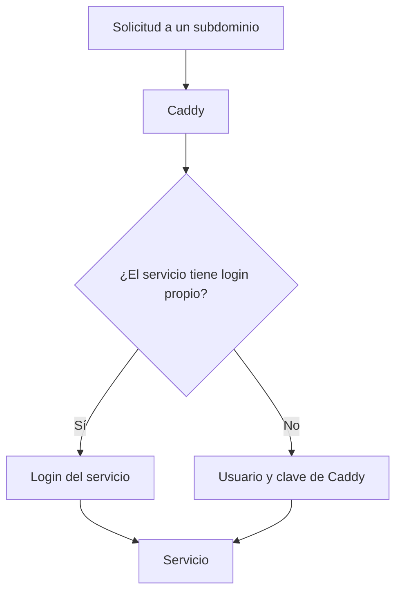
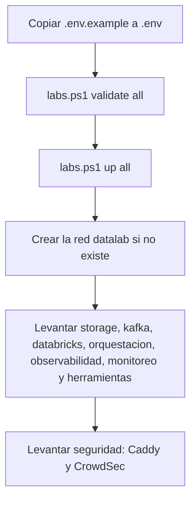

# Docker Stacks

Laboratorio local de microservicios para practicar ingeniería de datos y administrar un home lab. Simula plataformas como Kafka (con Zookeeper y con KRaft) y Databricks, junto con servicios de almacenamiento (SQL Server, DB2, SFTP, MinIO y Apache), todo desplegado con Docker Compose y expuesto de forma controlada a internet con Caddy.


---

## Contenido

- [Características](#características)
- [Arquitectura](#arquitectura)
- [Grupos de servicios](#grupos-de-servicios)
- [Inicio rápido](#inicio-rápido)
- [Autenticación](#autenticación)
- [Estructura del repositorio](#estructura-del-repositorio)
- [Tecnologías y lenguajes](#tecnologías-y-lenguajes)
- [Documentación](#documentación)
- [Contribuir y seguridad](#contribuir-y-seguridad)
- [Licencia](#licencia)

---

## Características

- **Grupos independientes**: cada tema (Kafka, Databricks, almacenamiento, orquestación, observabilidad y monitoreo) tiene su propio stack. Puedes levantar uno solo o todos.
- **Red compartida**: los servicios que necesitan hablar entre grupos se conectan a la red `datalab`.
- **Entrada HTTP única**: Caddy atiende todos los subdominios, con HTTPS automático de Let's Encrypt.
- **Autenticación por capas**: los servicios con login propio usan el suyo; los que no tienen login se protegen con usuario y clave en Caddy.
- **Secretos fuera de git**: las contraseñas van en `.env`, y Compose se detiene si falta una.
- **Un comando para todo**: `scripts/labs.ps1` levanta, baja, valida y muestra el estado de los grupos.

---

## Arquitectura

El tráfico entra por el router, que reenvía los puertos a la PC. Caddy atiende HTTP y HTTPS; los TCP reservados (51430 a 51440) van directo a su contenedor. Los Postgres no publican puerto: se administran desde pgAdmin, por Caddy.



Los contenedores de cada grupo viven en su red interna. Los que necesitan comunicarse entre grupos, o que Caddy debe alcanzar, se unen también a `datalab`.



Así se decide cómo se protege cada subdominio:



Y así se levanta el laboratorio con `labs.ps1 up all`:



---

## Grupos de servicios

| Grupo | Stack | Servicios |
|---|---|---|
| `storage` | [`stacks/storage/compose.yaml`](stacks/storage/compose.yaml) | SQL Server, DB2, SFTPGo, MinIO, Apache |
| `kafka-zookeeper` | [`stacks/kafka-zookeeper/compose.yaml`](stacks/kafka-zookeeper/compose.yaml) | Zookeeper, Kafka, Kafka UI, Kafka Connect, Postgres |
| `kafka-kraft` | [`stacks/kafka-kraft/compose.yaml`](stacks/kafka-kraft/compose.yaml) | 3 brokers Kafka KRaft, Kafka UI, Kafka Connect, Postgres |
| `databricks` | [`stacks/databricks/compose.yaml`](stacks/databricks/compose.yaml) | Spark, Jupyter, MLflow, Hive Metastore con su Postgres, Vault |
| `orquestacion` | [`stacks/orquestacion/compose.yaml`](stacks/orquestacion/compose.yaml) | Airflow (con papermill) y su Postgres |
| `observabilidad` | [`stacks/observabilidad/compose.yaml`](stacks/observabilidad/compose.yaml) | Prometheus, Grafana, cAdvisor (las métricas del host las da `windows_exporter`, fuera de Docker) |
| `monitoreo` | [`stacks/monitoreo/compose.yaml`](stacks/monitoreo/compose.yaml) | Uptime Kuma, ntfy, Portainer |
| `herramientas` | [`stacks/herramientas/compose.yaml`](stacks/herramientas/compose.yaml) | pgAdmin, FileBrowser, Homepage |
| `seguridad` | [`stacks/seguridad/compose.yaml`](stacks/seguridad/compose.yaml) | Caddy, CrowdSec |

---

## Inicio rápido

### Requisitos

- Docker Desktop (o Docker Engine con el plugin de Compose v2).
- PowerShell 7 para ejecutar `scripts/labs.ps1`.
- Un dominio propio, con registros DNS que apunten a la IP pública de tu red.
- `windows_exporter` instalado como servicio de Windows, para las métricas del host (ver [Guía](docs/guia.md#2-requisitos-previos)).
- Para acceso desde internet: reenvío de puertos en tu router (ver [Guía](docs/guia.md)).

### Pasos

```powershell
# 1. Crear el archivo de secretos y completar los valores
Copy-Item .env.example .env

# 2. Validar los stacks sin levantar nada
.\scripts\labs.ps1 validate all

# 3. Levantar todo el laboratorio
.\scripts\labs.ps1 up all

# 4. Revisar el estado
.\scripts\labs.ps1 status
```

Para levantar o bajar un solo grupo:

```powershell
.\scripts\labs.ps1 up databricks
.\scripts\labs.ps1 down databricks
```

La [guía del laboratorio](docs/guia.md) explica cómo generar el hash de Caddy, la clave de Airflow, los registros DNS y cómo entrar a cada servicio. Para el primer login de cada grupo, sigue la [guía de inicio](docs/guia-inicio.md).

---

## Autenticación

- **Con login propio**: SFTPGo, MinIO, Vault, Airflow, Grafana, Uptime Kuma, ntfy, pgAdmin, FileBrowser y Jupyter (con token).
- **Con usuario y clave de Caddy**: Apache, Kafka UI, Kafka Connect, MLflow, Spark UI y Prometheus.
- **Doble capa**: Portainer, primero con la clave de Caddy y después con su propio login.

La decisión está registrada en [ADR 0004](docs/adr/0004-autenticacion-por-capas-en-caddy.md). Las reglas de puertos están en [ADR 0005](docs/adr/0005-postgres-sin-puertos-y-reglas-de-puertos.md) y en la [guía](docs/guia.md#51-router).

---

## Estructura del repositorio

```
docker-stacks/
├── stacks/          # Un stack de Docker Compose por grupo
├── scripts/         # labs.ps1: up, down, status, validate
├── docs/            # Guía, decisiones de arquitectura (ADR) y agentes
├── .env.example     # Plantilla de variables (el .env real no se versiona)
├── GLOSSARY.md      # Vocabulario del proyecto
├── CLAUDE.md        # Configuración para agentes de IA
├── CONTRIBUTING.md
├── SECURITY.md
└── LICENSE
```

---

## Tecnologías y lenguajes

| Lenguaje o formato | Uso |
|---|---|
| **YAML** | Stacks de Docker Compose, configuración de Prometheus y CrowdSec |
| **PowerShell** | `scripts/labs.ps1` para levantar, bajar y validar |
| **Python** | DAG de Airflow, consumidores de Kafka y tareas de Spark |
| **Jupyter Notebook** | Pruebas de conexión con MinIO, Vault, Delta y Conexiones |
| **Caddyfile** | Configuración de Caddy como proxy inverso |
| **HCL** | Configuración de Vault |
| **Markdown** | Documentación y decisiones de arquitectura |

Servicios principales: Apache Kafka, Apache Spark, Apache Airflow, Debezium, Databricks (simulado con Spark, Jupyter y Delta), Hive Metastore, MLflow, HashiCorp Vault, MinIO, SQL Server, DB2, SFTPGo, Apache httpd, Caddy, CrowdSec, Prometheus, Grafana, windows_exporter, cAdvisor, Uptime Kuma, ntfy, Portainer, pgAdmin, FileBrowser y Homepage.

---

## Documentación

- [Guía del laboratorio](docs/guia.md): uso, implementación y solución de problemas.
- [Guía de inicio](docs/guia-inicio.md): por cada grupo, qué servicios tiene y cómo hacer el primer login.
- [Decisiones de arquitectura](docs/adr/): por qué se eligió cada enfoque.
- [Índice de documentación](docs/README.md).
- [Glosario](GLOSSARY.md): términos del proyecto (grupo, stack, servicio, topic).

---

## Contribuir y seguridad

- Lee [CONTRIBUTING.md](CONTRIBUTING.md) antes de enviar cambios.
- Para reportar una vulnerabilidad, sigue las instrucciones de [SECURITY.md](SECURITY.md) y no abras un issue público.
- Nunca subas `.env`, `credenciales.md` ni archivos con contraseñas. La carpeta `old/` está ignorada por git.

---

## Licencia

Este proyecto está bajo la [licencia MIT](LICENSE). Puedes usarlo, modificarlo y redistribuirlo, siempre que conserves el aviso de copyright.
